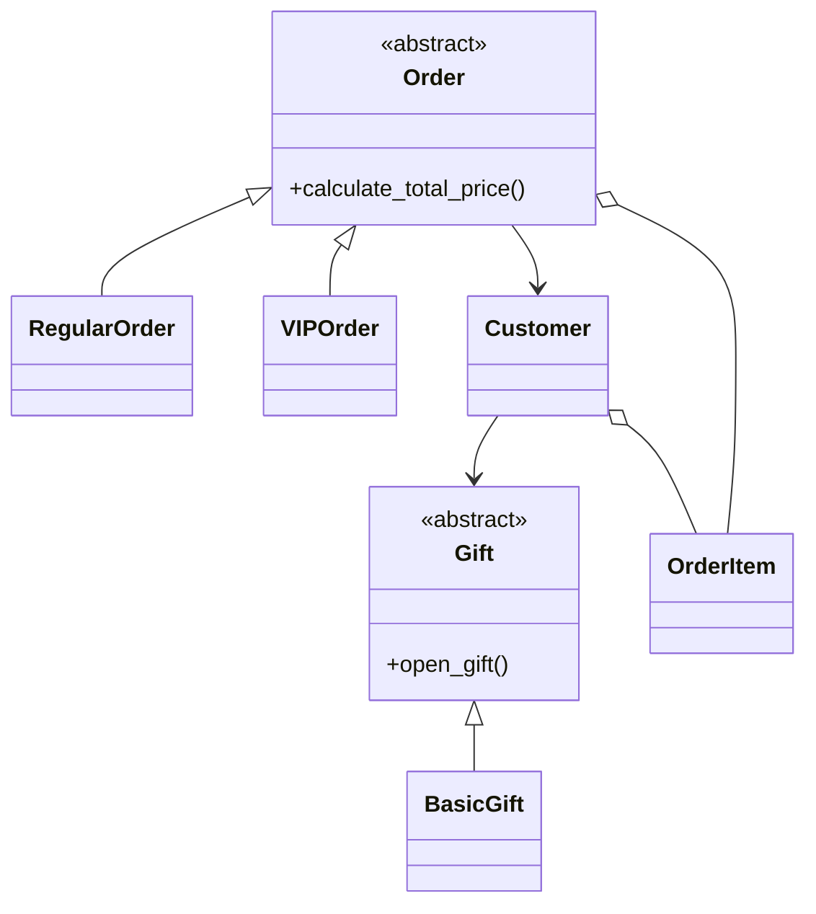

# Order Management System

My solution for the Python OOP exam: a small system that manages orders for website customers. It supports regular and VIP orders, customers with favorite items and gifts, and ids that are unique across the whole system.

## How to run

Open a terminal in the project folder and run:

```
python main.py
```

`main.py` is a demo. It walks through every feature and prints a labeled result for each one, so you can check each result against its label.

## Project structure

Every class lives in its own file:

- `payment_type.py`, `customer_type.py`: the two enums
- `not_vip_customer_error.py`: the error raised when a non-VIP customer makes a VIP order
- `gift.py`, `basic_gift.py`: the abstract gift and one concrete gift
- `order_item.py`, `customer.py`
- `order.py`: the abstract base order, with `regular_order.py` and `vip_order.py` built on it
- `main.py`: the demo

## Class diagram



## Design decisions

The spec left some things open. Here is what I chose.

- **Discount:** a fraction between 0 and 1, so 0.1 means 10% off. `None` means no discount, and anything outside 0 to 1 is rejected with a `ValueError`. A VIP customer with no discount pays full price.
- **Unique ids:** order ids, item ids, and customer ids are each unique across the whole system, tracked with a set stored on the class. A duplicate raises a `ValueError`. The same item also can't appear twice in one order.
- **Favorites:** matched by name, so an item with the same name but a different id counts as the same favorite. Removing a favorite that isn't in the list does nothing.
- **Abstract classes:** `Order` and `Gift`. `RegularOrder` and `VIPOrder` only implement `calculate_total_price`. Gifts must inherit from `Gift`, so anything passed to `take_gift` is guaranteed to have `open_gift()`.
- **VIP check:** `NotVipCustomerError` is raised while the VIP total is being calculated, before the order id is registered and before the customer's favorites change. A failed order leaves nothing behind.
- **Validate first:** every constructor checks its input before registering an id, so a failed constructor doesn't use one up.
- **Item list:** an order keeps its own copy of the items list, so changing the original list later doesn't affect the order.